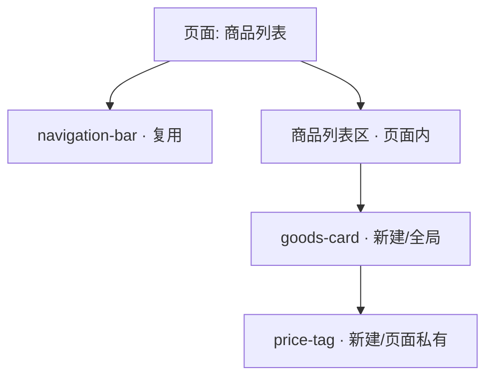

# Figma → 微信小程序页面（组件化转换）

把 Figma 设计转换为**组件化**的微信小程序页面。核心原则：**合理分析后再拆**，能复用就复用，**不为组件化而组件化，不为抽样式而抽样式**。

## 两阶段流程（强制）

```
- [ ] 阶段一：只读分析 → 产出分析报告 → 停下等用户确认
- [ ] 阶段二：用户确认后 → 生成代码
```

**阶段一只读**：只调用 Figma 读取工具 + 读取本项目现有代码，产出报告，**不写任何文件**。必须等用户确认组件拆分与落位方案后，才进入阶段二。

---

## 阶段一：分析

### 1. 解析链接并拉取设计

从 `figma.com/design/:fileKey/:fileName?node-id=1-2` 提取 `fileKey` 与 `nodeId`（把 `-` 转成 `:`，如 `1:2`）。若链接无 `node-id`，向用户索要节点级链接。

按需调用（`plugin-figma-figma`）：
- `get_metadata`(fileKey, nodeId) — 先看结构树（节点层级/类型/名称/尺寸），据此规划拆分。
- `get_design_context`(fileKey, nodeId) — 主力：参考代码 + 截图 + 令牌提示（React/Tailwind 仅作**参考**，勿照搬）。
- `get_variable_defs`(fileKey, nodeId) — 设计变量（颜色/间距/字号），用于对齐本项目令牌。
- `get_screenshot`(fileKey, nodeId) — 视觉核对（可选）。
- `get_code_connect_map`(fileKey, nodeId) — 若有映射，直接指向对应代码组件（可选）。

### 2. 盘点现有资产（必做，复用优先）

- 读 `components/` 下每个组件（看 `*.json` 的 `component`/`styleIsolation`、`*.wxml` 结构、`properties`），判断能否直接复用或扩展。
- 读 `styles/variables.wxss`（令牌：颜色/间距/圆角/阴影/`--font-size-*`/`--font-scale`）与 `styles/mixins.wxss`（可复用类：`.flex-*`/`.card-mixin`/`.button-*`/`.tag-*` 等）。
- 参考 `.cursor/rules/` 中的样式与 WXML 约束。

### 3. 组件化判定（启发式）

对页面每个模块逐一判断，**满足下列任一才建议组件化**；都不满足则**直接写在页面里**：

- 跨页面复用（当前或可预见的其它页面会用）；
- 页面内被使用 ≥ 2 次（列表项、卡片、标签等重复单元）；
- 有独立的状态 / 交互（可点击、可切换、内部维护数据）；
- 结构与语义自成一体、边界清晰（导航栏、弹窗、表单项等）。

反面信号（**不要**组件化）：一次性布局容器、纯静态文案块、仅出现一次且无交互的区域、拆了反而增加 `properties` 传参复杂度的碎片。

### 4. 组件落位建议（我建议，用户拍板）

对每个**新建**组件给出落位建议，并说明理由，**最终由用户确认**：
- **全局 `components/`**：多页面复用；
- **分包内组件**：仅某个分包内复用（在该分包目录下建 `components/`）；
- **页面私有 `pages/<page>/components/`**：仅当前页面复用（≥2 次但不跨页）。

### 5. 样式与令牌复用分析

- Figma 变量 → **优先映射**到 `variables.wxss` 已有令牌（颜色/间距/圆角/阴影）。
- 缺失但**确属通用**的令牌 → 建议**新增到 `variables.wxss`**（列出建议名与值，待确认）。
- **一次性值**（仅此处用的特殊色/尺寸）→ 写在页面/组件**局部 wxss**，**不进全局**。
- 可复用的类样式 → 用 `mixins.wxss` 已有类；模块级重复样式可建组件私有 class，不塞全局。

### 6. 字号（可调，必须遵守）

- 文本字号**一律用** `var(--font-size-*)`，把 Figma 字号映射到最近档位（20/24/28/32/36/40 rpx 基准）。**禁止**写死 `font-size: 28rpx`。
- 页面顶层放一行让整页跟随用户字号（无需逐个 view 加 class）：
```xml
<page-meta page-style="--font-scale: {{fontScale}};"></page-meta>
```
  并在页面 js 的 `onLoad` 里调 `fontSize.bindPage(this)`、`onUnload` 里调 `fontSize.unbindPage(this)`（`utils/font-size.js`）。

### 7. 产出分析报告（写成文件，然后停下）

把报告**写入文件** `docs/design-sync/<页面名>.md`（目录不存在则创建），再在对话里给出摘要与文件路径。报告末尾列出**待确认项**，等待用户回复；用户确认后可在同文件追加"最终方案"再进入阶段二。

报告模板：

```markdown
## 设计转换分析：<页面名>

### 组件清单
| 模块 | 建议 | 复用/新建 | 建议落位 | 判定理由 | 涉及令牌/mixin |
|---|---|---|---|---|---|
| 顶部导航 | 复用 | 复用 navigation-bar | components/ | 已有同款 | --text-primary |
| 商品卡片 | 组件化 | 新建 goods-card | 全局 components/ | 列表内复用≥2次 | .card-mixin, --spacing-md |
| 页头 Banner | 不组件化 | 页面内直写 | pages/xxx | 一次性、无交互 | --bg-light |

### 组件层级图
（mermaid，见下）

### 样式 / 令牌映射
| Figma 变量 | 映射到 | 处理 |
|---|---|---|
| color/brand #ee2b5b | --primary-color | 复用现有 |
| spacing/20 | （无） | 建议新增 --spacing-xxl? 或就近映射 |
| 卡片专用渐变 | — | 一次性，写 goods-card 局部 |

### 字号映射
| 文本 | Figma | 映射档位 |
|---|---|---|
| 标题 | 32px | var(--font-size-lg) |

### 待确认
1. goods-card 放全局还是页面私有？
2. 是否新增 --spacing-xxl 令牌？
3. ……
```

**mermaid 组件层级图**用 `graph TD`，页面为根，标注复用/新建：


---

## 阶段二：生成代码（用户确认后）

### 落地顺序

```
- [ ] 1. 按确认方案创建/复用组件（wxml + wxss + json，js 最小骨架）
- [ ] 2. 组装页面 wxml，引用组件，顶层加 page-meta
- [ ] 3. 页面/组件 wxss：优先 var(--*) 与 mixins 类，局部样式留本地
- [ ] 4. 经确认的通用新令牌 → 加入 styles/variables.wxss
- [ ] 5. 注册页面（app.json pages / 分包 subPackages）
- [ ] 6. 下载图片/图标资源到 images/
- [ ] 7. 自检清单逐项核对
```

### 组件规范

- `*.json`：`{ "component": true, "usingComponents": {} }`。**若组件内部需要用到全局 `mixins.wxss` 的类**，加 `"styleIsolation": "apply-shared"`（与现有 `navigation-bar` 一致）；否则组件内 class 不会吃到全局样式（CSS 变量 `var(--*)` 不受隔离影响，始终可用）。
- `*.js`：`Component({ properties, methods })`，本 skill 只给**最小骨架**（属性定义 + `triggerEvent` 事件位），不写完整业务逻辑。
- `*.wxml`：数据用 `{{}}`；**禁止**在 WXML 里写 JS 函数/复杂表达式（预计算放 js，见 `.cursor/rules/wxml-js-restrictions.mdc`）。

### JS 骨架模板

**页面版**（顶层 `page-meta` 让整页字号跟随用户设置；在自己的 `onLoad/onUnload` 各调一行，勿用对象混入以免覆盖生命周期）：
```javascript
// pages/<page>/<page>.js
const fontSize = require('../../utils/font-size.js')

Page({
  data: {
    // 预计算好的展示数据（勿在 WXML 里算）
  },

  onLoad() {
    fontSize.bindPage(this) // 注册字号监听 + 写入 data.fontScale
    // 拉取/初始化数据
  },

  onUnload() {
    fontSize.unbindPage(this)
  },
})
```
```xml
<!-- pages/<page>/<page>.wxml 顶层，仅此一行 -->
<page-meta page-style="--font-scale: {{fontScale}};"></page-meta>
```

**组件版**（`fontScaleBehavior` 可选：仅当组件 js 里需读取当前缩放数值时才加；组件文本用 `var(--font-size-*)` 本就自动跟随，多数组件无需引入）：
```javascript
// components/<name>/<name>.js
const { fontScaleBehavior } = require('../../utils/font-size.js')

Component({
  behaviors: [fontScaleBehavior], // 可选，提供 data.fontScale
  properties: {
    title: { type: String, value: '' },
  },
  data: {},
  methods: {
    onTap() {
      this.triggerEvent('tap', { /* payload */ })
    },
  },
})
```
```json
{ "component": true, "styleIsolation": "apply-shared", "usingComponents": {} }
```

### 样式落地规范

- 颜色/间距/圆角/阴影/字号 → `var(--*)`；可复用结构 → `mixins.wxss` 类。
- 尺寸用 **rpx**（本项目不做多端设备适配，靠 rpx + flex 自适应）。
- 一次性、模块专属样式 → 写在**组件/页面自己的 wxss**，绝不塞进 `app.wxss` / `variables.wxss` / `mixins.wxss`。
- 字号见阶段一第 6 条：`var(--font-size-*)` + 页面 `page-meta`。

### 资源

- 用 `download_assets`(fileKey, nodeId) 下载图片/图标，按返回的 `format` 存正确扩展名到 `images/`（图标优先 svg）。

## 完成自检

```
- [ ] 复用优先：现有组件/令牌/mixin 能用的都用了，无重复造轮子
- [ ] 组件化合理：每个新组件都满足启发式，无"为拆而拆"
- [ ] 落位经用户确认（全局 / 分包 / 页面私有）
- [ ] 字号可调：文本用 var(--font-size-*)，页面有 page-meta，无写死字号
- [ ] 样式归位：一次性样式在局部，仅通用令牌进全局且已确认
- [ ] WXML 无 JS 函数/复杂表达式
- [ ] 页面已在 app.json / subPackages 注册，资源已下载
```
