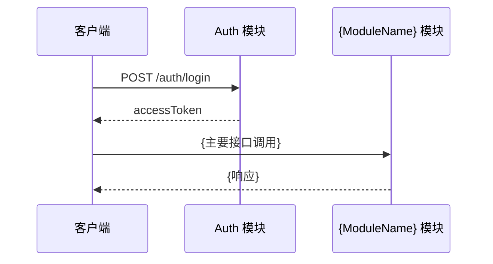

# {ModuleName} 模块接口调用说明

> {一句话描述模块职责}。  
> 对应代码：`src/modules/{module}/`  
> Swagger 在线文档：`/api-docs`（Tag：`{ApiTag}`）

---

## 1. 概述

{ModuleName} 模块用于 {业务描述}。

**核心行为：**

- {核心行为 1，来自 Service}
- {核心行为 2}
- {权限/安全相关行为}

---

## 2. 通用约定

### 2.1 基础地址

| 项 | 说明 |
|---|---|
| 默认端口 | `3000`（可通过环境变量 `APP_PORT` 或 `PORT` 覆盖） |
| 路径前缀 | {无全局前缀，或写明前缀} |
| Content-Type | `application/json` |

示例 Base URL：`http://localhost:3000`

### 2.2 鉴权

{说明本模块是否全部需要 JWT，或哪些接口为 @Public()}

| Header | 必填 | 说明 |
|---|---|---|
| `Authorization` | {是/否} | `Bearer <accessToken>`，通过 `POST /auth/login` 获取 |

鉴权通过后，`req.user` 为当前登录的 `FamilyMemberDto`，本模块主要使用以下字段：

| 字段 | 类型 | 说明 |
|---|---|---|
| `id` | `string` | 当前成员 ID（bigint 字符串） |
| `groupId` | `string \| null` | 当前成员所属家庭组 ID；未加入任何组时为 `null` |
| {其他字段} | {类型} | {说明} |

### 2.3 统一响应格式

#### 成功响应

```json
{
  "code": 0,
  "data": {},
  "timestamp": "2026-07-08T12:00:00.000Z"
}
```

| 字段 | 类型 | 说明 |
|---|---|---|
| `code` | `number` | 业务状态码，成功固定为 `0` |
| `data` | `T` | 业务数据，类型因接口而异 |
| `timestamp` | `string` | 响应时间，ISO 8601 格式（UTC） |

#### 失败响应

```json
{
  "code": 400,
  "data": null,
  "error": "错误描述",
  "errorCode": "BAD_REQUEST",
  "timestamp": "2026-07-08T12:00:00.000Z"
}
```

| 字段 | 类型 | 说明 |
|---|---|---|
| `code` | `number` | HTTP 状态码，与响应 HTTP Status 一致 |
| `data` | `null` | 失败时恒为 `null` |
| `error` | `string` | 人类可读的错误信息 |
| `errorCode` | `string` | 机器可读错误码，前端可据此分支处理 |
| `timestamp` | `string` | 响应时间，ISO 8601 格式（UTC） |

**常见 `errorCode`：**

| errorCode | HTTP Status | 说明 |
|---|---|---|
| `BAD_REQUEST` | 400 | 请求参数校验失败 |
| `UNAUTHORIZED` | 401 | 未登录或 Token 无效/过期 |
| `FORBIDDEN` | 403 | 无权操作该资源 |
| `NOT_FOUND` | 404 | 资源不存在 |
| `CONFLICT` | 409 | 资源冲突 |
| `INTERNAL_ERROR` | 500 | 服务器内部错误 |

---

## 3. 数据模型

### 3.1 {ResponseDto}（响应对象）

{说明哪些接口返回此结构}

| 字段 | 类型 | 说明 |
|---|---|---|
| `{field}` | `{type}` | {说明} |

**示例：**

```json
{
  "{field}": "{exampleValue}"
}
```

### 3.2 {CreateDto}（创建请求体）

| 字段 | 类型 | 必填 | 校验规则 | 说明 |
|---|---|---|---|---|
| `{field}` | `{type}` | {是/否} | {规则} | {说明} |

### 3.3 {UpdateDto}（修改请求体）

{说明 PartialType 关系；至少传一个字段}

| 字段 | 类型 | 必填 | 校验规则 | 说明 |
|---|---|---|---|---|
| `{field}` | `{type}` | 否 | {规则} | {说明} |

---

## 4. 接口详情

### 4.1 {接口中文名}

{一句话描述接口用途}

| 项 | 值 |
|---|---|
| **方法** | `{METHOD}` |
| **路径** | `/{path}` |
| **鉴权** | {需要 Bearer Token / 公开} |

#### 请求头

| Header | 必填 | 说明 |
|---|---|---|
| `Authorization` | {是/否} | `Bearer <accessToken>` |
| `Content-Type` | {是/否} | `application/json` |

#### 路径参数

| 参数 | 类型 | 必填 | 说明 |
|---|---|---|---|
| `{param}` | `{type}` | {是/否} | {说明} |

> 无路径参数时写：**无。**

#### 查询参数

| 参数 | 类型 | 必填 | 说明 |
|---|---|---|---|
| `{param}` | `{type}` | {是/否} | {说明} |

> 无查询参数时写：**无。**

#### 请求体（{DtoName}）

```json
{
  "{field}": "{exampleValue}"
}
```

| 字段 | 类型 | 必填 | 说明 |
|---|---|---|---|
| `{field}` | `{type}` | {是/否} | {说明} |

> 无请求体时写：**无。**

#### 成功响应

- **HTTP Status：** `200`
- **data 类型：** `{DtoName}` 或 `{DtoName}[]` 或 `null`

```json
{
  "code": 0,
  "data": {},
  "timestamp": "2026-07-08T12:00:00.000Z"
}
```

#### 业务说明

1. {步骤或规则 1}
2. {步骤或规则 2}

#### 可能的错误

| HTTP Status | errorCode | error 示例 | 触发场景 |
|---|---|---|---|
| {status} | `{ERROR_CODE}` | `{message}` | {场景} |

#### 调用示例

```bash
curl -X {METHOD} http://localhost:3000/{path} \
  -H "Authorization: Bearer <accessToken>" \
  -H "Content-Type: application/json" \
  -d '{requestBody}'
```

---

{为每个接口复制 4.x 小节，递增编号}

---

## 5. 典型调用流程



---

## 6. 注意事项

1. **ID 类型：** 所有 ID 字段在数据库中为 `bigint`，API 层以**字符串**形式传输。
2. {模块特有注意事项}
3. {关联模块/级联影响}

---

## 7. 版本信息

| 版本 | 日期 | 说明 |
|---|---|---|
| 1.0 | {YYYY-MM-DD} | 初始版本，基于 `src/modules/{module}` 当前实现生成 |
